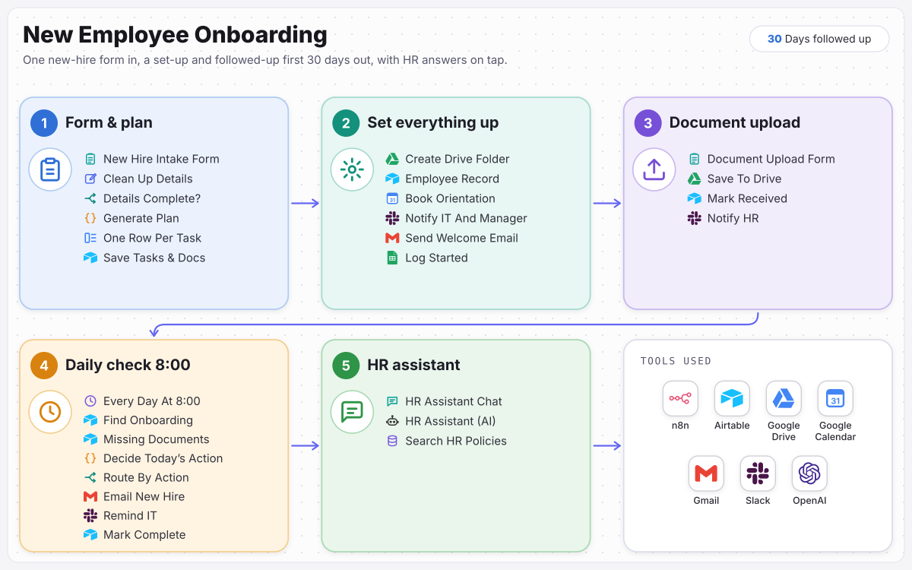

# New Employee Onboarding

A new hire is fully set up from one form, and followed up for their first 30 days.

> Built for **Casa Marindo Hotel Group**, a fictional sample client. The business, people and data are invented; the workflow is complete and runs.

One new-hire form sets up a Drive folder, employee record, orientation, IT access request and welcome email, then tracks every task and document. A daily check sends reminders and check-ins up to day 30, and the HR team has a chat assistant that answers policy questions from company policy only.

**Full case study:** [ramonvallejera.com/case-study/hotel-employee-onboarding](https://ramonvallejera.com/case-study/hotel-employee-onboarding)

## How it works

1. New hire form
2. Onboarding plan for the role
3. Folder, record, orientation, IT request and welcome email
4. Tasks and documents tracked
5. Daily reminders and check-ins to day 30
6. Policy assistant for the HR team

Built an n8n workflow where HR fills in one form. It builds the onboarding plan for that role, sets up the Drive folder, employee record, orientation and IT request, sends the welcome email, and records every task and document in Airtable. A daily check sends milestone check-ins and document reminders up to day 30, chases IT for access and key cards, and closes onboarding when everything is done. The HR team gets a chat assistant that answers policy questions using only company policy.

## What's in this repo

| File | What it is |
|---|---|
| `workflow.json` | The n8n workflow, 64 nodes, ready to import |
| `docs/process-map.svg` | The process map from the case study |

Triggers: `New Hire Intake Form`, `Document Upload Form`, `Every Day At 8:00`, `HR Assistant Chat`, `Load HR Policies (Run Manually)`, `When Workflow Fails`.

## Set it up

1. In n8n, open **Workflows → Import from File** and choose `workflow.json`.
2. Create these credentials and select them on the nodes that need them:

   - Airtable (personal access token) (10 nodes)
   - Slack (OAuth2) (7 nodes)
   - Google Drive (OAuth2) (3 nodes)
   - Google Sheets (OAuth2) (3 nodes)
   - OpenAI (3 nodes)
   - Gmail (OAuth2) (2 nodes)
   - Google Calendar (OAuth2) (1 node)

3. Replace the placeholders with your own records:

   - `YOUR_AIRTABLE_BASE_ID` (10×)
   - `YOUR_AIRTABLE_TABLE_ID` (10×): each node keeps the original table name as a hint
   - `YOUR_CALENDAR_ID` (1×)
   - `YOUR_DRIVE_FILE_ID` (1×)
   - `YOUR_DRIVE_FOLDER_ID` (2×)
   - `YOUR_DRIVE_ID` (2×)
   - `YOUR_GOOGLE_SHEET_ID` (3×)
   - `YOUR_SLACK_CHANNEL_ID` (7×): the channel that receives alerts and approvals
   - `your-n8n-instance.example.com` (2×): your n8n base URL

4. Run it once with test data, then activate it.

Tools: n8n, Airtable, Google Drive, Google Calendar, Gmail, Slack, OpenAI.

## Notes

- Credentials, webhook IDs, pinned test data and account-specific IDs were removed before publishing. n8n assigns new webhook URLs on import.
- Built by [Ramon Vallejera Jr.](https://ramonvallejera.com), AI Automation Engineer. Questions or a build like this for your team: [ramonvallejera.com/contact](https://ramonvallejera.com/contact).
